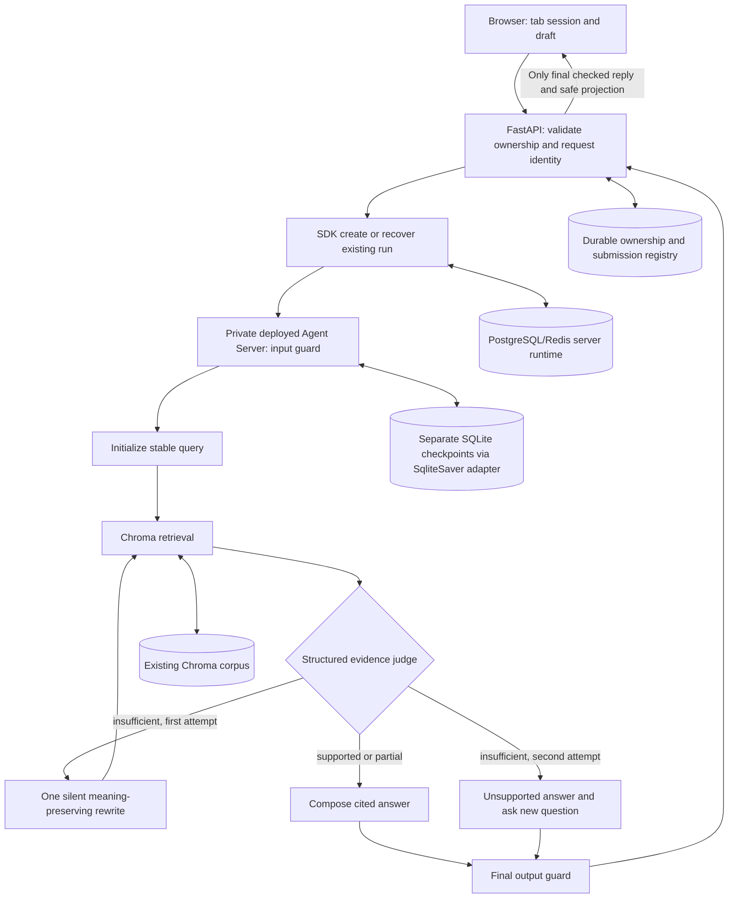

# Phase 01: Persistent Grounded Policy Chat - Research
**Researched:** 2026-11-10 · **Domain:** deployed LangGraph policy RAG, synchronous SQLite persistence, safe session chat · **Confidence:** MEDIUM

<user_constraints>
## User Constraints (from CONTEXT.md)
The following blocks reproduce the decisions and deferred scope verbatim. [VERIFIED: .planning/phases/01-persistent-grounded-policy-chat/01-CONTEXT.md:18-60,134-136]
<!-- DATA_P7aK4mX2_START -->
## Implementation Decisions

### Answers and Sources

- **D-01:** Match the customer's message language. English questions receive English answers; Polish questions receive Polish answers.
- **D-02:** Answer concisely by default: a direct answer in 2–4 sentences, using bullets when useful. This does not require omitting relevant caveats or compressing a four-facility comparison into an unreadable paragraph.
- **D-03:** Put source citations inline beside the supported claims. Retain document and page identity so citations can be checked; do not expose private filesystem paths or raw internal state.
- **D-04:** Use a friendly, straightforward tone: natural, polite, and practical.

### Conversation Continuity and Checkpoint Storage

- **D-05:** Refreshing the page restores its current messages and continues the same thread.
- **D-06:** Closing and reopening the browser starts a fresh conversation. Do not automatically reopen the previous thread across that browser-session boundary. Previously stored threads are not deleted by this behavior.
- **D-07:** Each tab has its own conversation/thread. Opening or duplicating a tab must not unintentionally share the originating tab's thread; refresh within a tab retains its own thread.
- **D-08:** New chat starts a fresh thread immediately, without confirmation, and leaves the previous thread stored. A history browser or automatic thread deletion was not requested.
- **D-09:** Use `SqliteSaver` for graph checkpoints in a separate SQLite database, distinct from `ingested_mock_data/parking_november_2026.sqlite3`. This is an explicit user implementation constraint and applies to application persistence, not merely tests.
- **D-10:** Create the checkpoint database connection outside the graph. Keep it in a local variable/closure accessible to graph construction/checkpointer wiring; do not pass the connection as runtime context or store a live connection in graph state. Manage its lifetime outside graph-node execution.
- **D-11:** D-09/D-10 supersede the earlier research recommendation to rely exclusively on the Agent Server's default PostgreSQL checkpointer. PostgreSQL/Redis may remain required server infrastructure; their existence does not satisfy the requested separate SQLite checkpoint persistence.
- **D-12:** Verify the pinned Agent Server's custom-checkpointer integration, async method requirements, and conformance against the exact requested `SqliteSaver` arrangement. The official custom-checkpointer guide describes an async lifecycle and required async operations, so this is a planning/setup compatibility gate. Do not silently substitute `AsyncSqliteSaver`, PostgreSQL checkpoints, or an in-process API graph; report any unresolved incompatibility explicitly.

### Unclear and Unsupported Questions

- **D-13:** If a facility-specific question names no facility and none is clear from context, briefly compare all four facilities (CTR, RIV, STA, AIR) instead of asking the customer to select one first. Compare only supported facts and keep the presentation concise.
- **D-14:** When evidence answers only part of a comparison or question, answer supported parts with citations and clearly mark the remaining information as unavailable. Missing evidence for one facility must not produce invented facts about it.
- **D-15:** If evidence is insufficient, have the LLM rewrite the retrieval query once to improve semantic matching while preserving the customer's original meaning. Retrieve again and reassess evidence. This is a bounded single retry, not an unbounded loop or permission to answer from general model knowledge.
- **D-16:** Keep the original customer message/query identity. Record any rewritten query, attempt, and retrieved evidence internally under the same question; preserve earlier question evidence. A search rewrite must not become a new customer message or erase the first retrieval attempt.
- **D-17:** If the second retrieval/assessment still cannot support an answer, state that the question is unsupported by the available information and ask the customer for a new question. Use the selected language and friendly, concise tone.
- **D-18:** The rewrite/retrieval retry is silent. Do not show rewritten queries, search status, evidence-judge details, or internal processing to the customer. Dependency failures remain explicit service errors rather than being disguised as insufficient evidence or triggering a semantic rewrite by themselves.

### Chat Interaction and Recovery

- **D-19:** Customers see only the final checked reply. Do not display internal steps or progress labels such as Checking, Searching documents, Checking the answer, or query-rewrite status. Do not stream unguarded partial responses or raw tool/graph events to the browser.
- **D-20:** While a request is pending, allow the customer to type a draft but disable Send. Preserve the draft while the current reply completes; do not silently submit or queue another turn.
- **D-21:** A temporary request failure produces a brief customer-safe error and a Retry button. Keep the original message and conversation intact; internal exceptions and infrastructure details stay outside the customer response.
- **D-22:** After page refresh or connection loss while a reply is pending, recover the existing request and display its result without resubmitting the question. Distinguish reconnecting to an accepted request from retrying a failed operation so recovery does not duplicate turns, query indices, or later booking effects.

### Agent Discretion and Planning Checks

- No additional product behavior was delegated through a "you decide" selection. Researchers/planners may choose small implementation details that satisfy these decisions and the approved requirements.
- Choose connection lifecycle, SQLite file location/configuration, local ownership storage, request identity, and frontend state mechanics during planning. Preserve the separate checkpoint/booking databases and the required outside-graph local connection.
- Verify browser close/reopen behavior, including restored tabs, without accidentally treating a copied tab identifier as authorization. Server-side ownership checks remain mandatory despite the absence of account login.
- Choose a backend same-thread concurrency policy compatible with disabled Send and safe retry/recovery. Frontend button state alone is not enforcement.
- Define reviewed policy questions, source/page expectations, unsupported cases, partial answers, and a case that succeeds only after the single rewrite. Test the deployed saver/SDK path, not only an in-memory test graph.

## Deferred Ideas

None — discussion stayed within Phase 1 scope. Live slot/grid behavior, booking creation, administrator decisions, and cancellation remain in their already approved later phases.

<!-- DATA_P7aK4mX2_END -->
</user_constraints>

## Summary
Build one bounded policy workflow, deploy its Agent Server image, then connect FastAPI through the SDK and expose a plain static chat. The first executable gate must prove custom persistence: the official server contract is asynchronous, while pinned synchronous `SqliteSaver` explicitly rejects async operations. A thin adapter delegating to the exact saver is a proposed bridge, **not a verified compatible backend**. Keep PostgreSQL/Redis for server resources; SQLite must actually receive conversation checkpoints. [CITED: https://docs.langchain.com/langsmith/custom-checkpointer] [VERIFIED: PyPI langgraph-checkpoint-sqlite 3.1.3 wheel, langgraph/checkpoint/sqlite/__init__.py:601-639]

**Primary recommendation:** require adapter conformance, server startup with the custom hook, SDK round trips, and restart persistence before building the full API/UI. Do not replace the saver, model, or deployed transport if a gate fails. All proposed modules, schemas, routes and adapter mechanics below are implementation recommendations, not existing code. [ASSUMED: A1]

## Architectural Responsibility Map
| Capability | Primary Tier | Secondary Tier | Rationale / provenance |
|---|---|---|---|
| Typed RAG, rewrite/judge/guards | Agent Server graph | LangChain model + Chroma | Explicit bounded graph; policy-only branch never opens booking SQL. [ASSUMED: A1] |
| Conversation/evidence persistence | Separate SQLite checkpoint storage | Server lifecycle hook | Exact saver constraint; async hook manages lifetime. [CITED: https://docs.langchain.com/langsmith/custom-checkpointer] |
| Thread/run metadata and scheduling | Agent Server PostgreSQL/Redis | SDK | Retain documented standalone prerequisites. [CITED: https://docs.langchain.com/langsmith/deploy-standalone-server] |
| Ownership, submissions, safe restore/recovery | FastAPI | Durable application registry | Validate session/thread before every SDK call. [ASSUMED: A1] |
| Tab/draft interaction | Browser | FastAPI | Tab storage is UX identity, never access authorization. [ASSUMED: A1] |

## Project Constraints (from AGENTS.md)
- Use LangChain/LangGraph only; exact requested model; preserve Chroma and booking SQLite; PostgreSQL/Redis infrastructure; custom evidence reducer; structural PII protection; no customer/admin login or application API keys; image before SDK hookup; readiness dependencies; readable code and pytest coverage. Later booking work must use transactional overlap prevention including pending holds. [VERIFIED: AGENTS.md:15-24]
- Preserve persisted facility/slot/reservation identities and SQL names; descriptive snake_case; four-space indentation, double quotes, f-strings; triple-quoted SQL with bound placeholders; script-relative fixture resolution; repository-relative POSIX document metadata; preserve persistence constraints/cleanup; avoid import-time execution of seed modules. Explain domain caveats and setup prerequisites; do not infer app framework choices from developer tooling. [VERIFIED: AGENTS.md:42,88-152,174-179,234-251]
- Work through GSD before edits; this artifact belongs to the already active plan-phase workflow. No configured phase-researcher skills were returned by the bootstrap query; graphify status reported disabled, so no graph findings are asserted. [VERIFIED: AGENTS.md:267-277] [VERIFIED: session bootstrap command output]

<phase_requirements>
## Phase Requirements
Descriptions below quote the approved requirement text; implementation support is prescribed here. [VERIFIED: .planning/REQUIREMENTS.md:11-16,21-26,43-56,65-67]
| ID | Description | Research Support |
|---|---|---|
| GRAPH-01 | The application uses `gpt-6-luna` through LangChain and LangGraph as its only agent frameworks; unavailable model access produces an explicit configuration error rather than a silent model substitution. | Exact model + explicit Responses structured-output probe. |
| GRAPH-02 | Graph input, output, main state, intent classification, evidence assessment, and booking details have explicit typed schemas validated at their boundaries. | TypedDict state/input/output; Pydantic boundaries and model schemas. |
| GRAPH-03 | Customers can continue a conversation using its `thread_id`, retaining messages and booking details across turns and deployed graph-server restarts. | Custom saver + persistent volume + deployed restart test. |
| GRAPH-04 | Each new question has a distinct query index, and its retrieved documents and SQL results remain in thread state after subsequent questions. | Durable request→query identity, immutable evidence map; no SQL retrieval yet. |
| GRAPH-06 | Concurrent submissions to the same thread are serialized or explicitly rejected so they cannot mix query indices, booking details, or replies. | SDK reject strategy plus durable submission uniqueness. |
| RAG-02 | Policy/general questions execute a dedicated Chroma retrieval node without running an unrelated SQL availability branch. | Dedicated vector node and topology assertion. |
| RAG-05 | An LLM judge returns structured evidence sufficiency, and conditional edges return a clear no-available-information response when the retrieved documents and records cannot support an answer. | Structured per-claim support; bounded rewrite branch and abstention. |
| RAG-07 | Policy queries use embeddings compatible with the stored collection, retain source/page identities, and retrieve evidence only within its supported scope; the existing collection remains intact while compatibility is established. | Provenance gate + reviewed real-Chroma pages. |
| PRIV-01 | Input guardrails block prompt-injection attempts that request hidden instructions, unrelated personal records, or unauthorized tool behavior. | Input guard, untrusted retrieval boundary, bounded tools. |
| PRIV-05 | A final output guardrail node blocks or scrubs unauthorized sensitive information before an assistant reply reaches the customer. | Guard is sole final-reply publisher; API allowlist. |
| API-01 | `POST /api/chat` accepts a message and `thread_id`, invokes the deployed Agent Server through `langgraph_sdk`, and returns the assistant reply plus a safe updated reservation-state projection. | Remote SDK gateway, final reply + typed empty/current safe reservation view. |
| API-05 | FastAPI enforces Pydantic request/response schemas, appropriate HTTP status codes, and explicitly configured CORS. | Typed request/result/recovery DTOs, explicit origins, safe error mapping. |
| DEL-02 | The graph is packaged and started as an Agent Server image using deployment JSON and declared dependencies before the FastAPI SDK integration is accepted. | Packaging and deployed smoke gate precede API integration. |
| DEL-04 | Graph startup waits for Chroma, PostgreSQL, and Redis readiness, and service addresses work from inside the deployed containers. | Healthy dependencies, service DNS, container-level probes. |
</phase_requirements>

## Standard Stack
Use Python 3.12, uv, the existing LangChain dependencies, and plain HTML/CSS/JavaScript. The manifest declares `requires-python = ">=3.12"`, `"chromadb==1.5.9"`, `"langgraph>=1.2.20"`, `"langchain-openai>=1.7.4"`, `"pydantic>=2.14.3"`; retain these existing constraints while generating a tested lock. [VERIFIED: pyproject.toml:6-19]

### Core and Supporting
Current PyPI metadata was fetched directly, including release dates and declared dependencies. These are **candidate pins, not a resolved/tested environment**. Official docs/source establish package identity; no package is represented as passing the legitimacy seam. [CITED: https://pypi.org/pypi/langgraph/json]
| Package | Version / published UTC | Purpose / source |
|---|---|---|
| langgraph | 1.2.20 / 2026-11-05 | StateGraph; [PyPI](https://pypi.org/pypi/langgraph/json). [CITED: pypi.org/pypi/langgraph/json] |
| langgraph-api | 0.17.1 / 2026-11-03 | Record matching deployed runtime/image version; PyPI version alone does not prove image contents or entitlement. [CITED: https://pypi.org/pypi/langgraph-api/json] |
| langgraph-checkpoint-sqlite | 3.1.3 / 2026-10-30 | Exact SqliteSaver; requires checkpoint >=4.3.1,<5. [CITED: https://pypi.org/pypi/langgraph-checkpoint-sqlite/json] |
| langgraph-checkpoint-conformance | 0.0.2 / 2026-04-08 | Official backend validator. [CITED: https://pypi.org/pypi/langgraph-checkpoint-conformance/json] |
| langgraph-sdk / langgraph-cli | 0.4.14 / 2026-11-06; 0.4.42 / 2026-11-06 | Remote gateway / image build; current CLI wheel supports custom hook. [CITED: https://pypi.org/pypi/langgraph-sdk/json] [CITED: https://pypi.org/pypi/langgraph-cli/json] |
| langchain-openai / langchain-chroma | 1.7.4 / 2026-11-04; 1.1.0 / 2025-12-12 | Existing model/retrieval adapters. [CITED: https://pypi.org/pypi/langchain-openai/json] [CITED: https://pypi.org/pypi/langchain-chroma/json] |
| pydantic / fastapi / uvicorn | 2.14.3 / 2026-11-05; 0.162.2 / 2026-11-07; 0.54.0 / 2026-09-25 | Typed API and static serving. [CITED: https://pypi.org/pypi/pydantic/json] [CITED: https://pypi.org/pypi/fastapi/json] [CITED: https://pypi.org/pypi/uvicorn/json] |
| pytest / pytest-asyncio / httpx | 9.2.0 / 2026-10-27; 1.4.1.post1 / 2026-11-01; 0.28.1 / 2024-12-06 | TestClient, async saver/deployment tests. [CITED: https://pypi.org/pypi/pytest/json] [CITED: https://pypi.org/pypi/pytest-asyncio/json] [CITED: https://pypi.org/pypi/httpx/json] |

Installation belongs to execution after the prerequisite/audit gate: add sqlite saver + SDK + FastAPI/Uvicorn runtime requirements and CLI/conformance/pytest/pytest-asyncio/HTTPX dev requirements using uv, resolve together, and pin the validated Agent Server image/digest. Do not add SQLAlchemy, frontend frameworks, PDF regeneration tooling, or booking migrations for this phase. [ASSUMED: A1]

## Package Legitimacy Audit
The escalated read-only seam returned `SUS` for every new package below; all registry identities/source URLs were present, weekly download telemetry was null. Recent-release flags describe release timestamps, not proof of maliciousness. No installs occurred. [VERIFIED: session package-legitimacy command output]
| Packages | Registry / release age | Downloads / source repo | Verdict / disposition |
|---|---|---|---|
| langgraph-checkpoint-sqlite | PyPI / 11d | unknown / langchain-ai/langgraph | SUS: too-new, unknown-downloads; retain for verification |
| langgraph-checkpoint-conformance | PyPI / ~7mo | unknown / langchain-ai/langgraph | SUS: unknown-downloads; retain for verification |
| langgraph-sdk, langgraph-cli | PyPI / 4d | unknown / langchain-ai/langgraph | SUS: too-new, unknown-downloads; retain for verification |
| fastapi | PyPI / 3d | unknown / fastapi/fastapi | SUS: too-new, unknown-downloads; retain for verification |
| uvicorn | PyPI / 46d | unknown / Kludex/uvicorn | SUS: unknown-downloads; retain for verification |
| pytest, pytest-asyncio | PyPI / 14d,9d | unknown / pytest-dev projects | SUS: too-new, unknown-downloads; retain for verification |
| httpx | PyPI / ~23mo | unknown / encode/httpx | SUS: unknown-downloads; retain for verification |

**WARNING: packages in this audit were flagged as suspicious — verify before using.** None received SLOP; none removed. Tooling rule source: `.codex/agents/gsd-phase-researcher.toml:223` explicitly says the planner must add a human verification task before installing a SUS package. DATA_B8nV2qR5_START: “The planner must add a `checkpoint:human-verify` task before installing this package.” DATA_B8nV2qR5_END. Planner must assess that future install gate against existing user authorization; this report requests no new approval and treats missing telemetry as uncertainty, not a security finding. [VERIFIED: .codex/agents/gsd-phase-researcher.toml:223]

## Architecture Patterns
### System Architecture Diagram

Diagram is the proposed Phase 1 flow; dependency errors leave through explicit safe service errors, never through the semantic rewrite/insufficiency branch. [ASSUMED: A1]

### Recommended Project Structure / Component Responsibilities
All names below are **proposed**, not verified existing filesystem paths. [ASSUMED: A1]
| Proposed module | Responsibility |
|---|---|
| src/parking/graph/state.py, reducers.py, schemas.py | Separate input/output/mainstate; typed evidence, query mapping, intent, assessment, booking draft. |
| src/parking/graph/nodes.py, graph.py | Input guard → retrieval/judge/rewrite/compose → output guard; exported graph. |
| src/parking/checkpoint.py | External connection lifecycle, exact saver adapter, custom server hook. |
| src/parking/retrieval.py, settings.py | Bounded Chroma read, embeddings, public citation mapping, explicit configuration failures. |
| src/parking/api/app.py, sessions.py, submissions.py, gateway.py | Lifespan SDK client, persistent ownership/request mapping, safe API projections and recovery. |
| src/parking/web/ | Simple static chat; final-only rendering, draft, New chat, Retry. |
| tests/unit/, tests/integration/, tests/live/, tests/cases/ | Isolated deterministic tests, deployed gates, configured live checks, reviewed evidence cases. |

### Critical Pattern: synchronous saver behind server async lifecycle
The **3.1.3 wheel inspected without installation** creates a saver lock, supports `check_same_thread=False`, provides synchronous `delete_thread`, and explicitly raises for asynchronous get/list/put. CLI **0.4.42 wheel** accepts `checkpointer.path`, rewrites its container path, and exports `LANGGRAPH_CHECKPOINTER`. This proves a configuration/source route; the exact deployed image and adapter remain unexecuted. [VERIFIED: PyPI sqlite wheel, __init__.py:74-100,188-210,498-510,601-639] [VERIFIED: PyPI CLI wheel, config.py:1141-1183,1283-1286; schemas.py:193-216]

Use an async context-manager factory with a **local connection variable outside graph construction**, a persistent separate checkpoint file, and shutdown after in-flight work drains. Prototype a small `SqliteSaver` subclass/adapter that offloads all five required async methods to the synchronous saver: `aget_tuple`→`get_tuple`, `aput`→`put`, `aput_writes`→`put_writes`, `adelete_thread`→`delete_thread`; `alist` must be an **async generator**, materializing the bounded synchronous iterator inside the worker before yielding. Preserve pinned signatures, keyword parameters, serializer/version behavior and namespace/filter semantics. [ASSUMED: A2]

Serialize database work on a dedicated worker; use `check_same_thread=False` if constructing the connection outside that worker. Do not return a live cursor/generator across threads, block the event loop, share a connection through runtime context/state, close it when a node completes, or assume cancellation stops a running SQLite worker. Drain/track cancelled work before connection close. Saver locking is source-supported; adapter cancellation/lifecycle and cross-process locking require execution tests. Mount a directory so journal sidecars persist; start with one server instance. [CITED: https://docs.python.org/3.12/library/sqlite3.html] [ASSUMED: A2]

**Gate:** run conformance including deletion/list/filter/history, verify custom-backend startup logs in the pinned image, write checkpoints through SDK, inspect the separate test file, restart server, recover prior evidence/messages and complete another turn. Check default server state APIs, thread cleanup, graph reload and concurrent threads. Do not advertise optional rollback/pruning/copy capabilities merely by inheriting unsupported methods. Failure remains an explicit compatibility issue; no AsyncSqliteSaver/Postgres/in-process fallback. [CITED: https://docs.langchain.com/langsmith/custom-checkpointer] [ASSUMED: A2]

### Typed state, reducer and bounded retrieval
Use TypedDict input/output/mainstate and Pydantic validation at HTTP/node/model boundaries; type hints alone are insufficient. Separate raw messages/evidence/draft from final safe reply. Input/output schemas do **not** hide internal streaming channels. [CITED: https://docs.langchain.com/oss/python/langgraph/graph-api]

Proposed state: stable request ID→query index; add_messages with deterministic user/assistant message IDs; original question, contextual retrieval question, rewritten query and attempt identity; typed booking draft retained without enabling booking tools; structured assessment with per-facility/per-claim evidence IDs and missing facts; evidence reducer indexed by query→source→attempt→document identity. Merge copied maps, preserve earlier questions and both attempts, reject conflicting immutable IDs, make identical replay idempotent. A semantic retry is attempt two of the same query; a recovered HTTP submission adds neither a message nor an index. Initialize/increment once before retrieval. Feed the answer only the selected current-question evidence. [ASSUMED: A1]

Pin compatible query embeddings after provenance review. The ingestion source uses `page = document.metadata["page"]`, `ids.append(f"{source}:page:{page}")`, `OpenAIEmbeddings(check_embedding_ctx_length=False)`, `collection_name="parking_documents"`; queries must preserve those source/page identities without importing the executable seed module. [VERIFIED: ingested_mock_data/seed_vector_ingest.py:35-53]
The README calls the default `text-embedding-ada-002`; this documents intended ingestion, **not proof of the persisted collection's historical model**. Check ingestion logs/collection metadata and reviewed retrieval. Equal dimensions alone are not identity evidence. Preserve original collection; a separately versioned rebuild requires an explicit compatibility/cost decision. [VERIFIED: ingested_mock_data/README.md:56-65] [ASSUMED: A3]

For unspecified facility questions, retrieve across all four facility guides plus relevant shared policies; do not rely on a single top-k result set covering every facility. Use a bounded corpus/source allowlist, scoped metadata mapping and configurable retrieval count selected by reviewed cases. Judge coverage per facility/claim; compose supported partial answers with inline public title/page references and explicitly unavailable portions. Validate cited IDs belong to current evidence; convert zero-based page to public page number. Dependency failures bypass rewriting. Exactly one LLM rewrite preserves original intent and is reassessed; the second insufficient result becomes the requested unsupported/new-question reply. [ASSUMED: A1]

### SDK recovery, ownership and tab lifetime
Use `runs.create` followed by `runs.get/join`; set `multitask_strategy="reject"` and retain accepted background runs while the browser disconnects. SDK source supports creation metadata and joining by run ID; rejection preserves the existing run. [CITED: https://raw.githubusercontent.com/langchain-ai/langgraph/main/libs/sdk-py/langgraph_sdk/_async/runs.py] [CITED: https://docs.langchain.com/langsmith/reject-concurrent]

Persist a unique (owner,thread,request ID) with payload fingerprint, submission status, accepted run ID and final safe result. Reserve identity before remote creation; attach request ID to run metadata. On a lost creation acknowledgement, reconcile the server's run list/metadata before retrying; **unknown acceptance must never cause blind recreation**. The installed SDK/server must prove this recovery route; do not invent a client-supplied run-ID/idempotency argument. Distinguish accepted pending/reconnect, proven failed operation Retry, and a new user submission. A process-local lock or disabled button is insufficient. [ASSUMED: A4]

Add only necessary ownership-checked thread-create, safe conversation-restore and request-status/recovery endpoints alongside the required chat route. Never proxy raw threads/state/history/runs. Use server-issued random session cookie, persistent owner bindings and validated opaque tab/thread handles; copying a thread ID grants no access. Safe transcript contains user text + guarded final replies only. Same-origin static serving, explicit local CORS/origin checks, safe response models; use 409 for busy/payload conflicts, validation errors for malformed input, safe 502/503 for dependency failures, and accepted/pending responses when recovery is needed. [CITED: https://fastapi.tiangolo.com/tutorial/response-model/] [ASSUMED: A1,A4]

SessionStorage survives refresh **and restores**, and a new opener can copy it. Use per-tab sessionStorage plus an ephemeral page-instance claim (for example Web Locks/BroadcastChannel collision handling) so a simultaneously duplicated tab obtains a new thread; remove opener for app-created tabs. Preserve draft while Send is disabled; New chat detaches immediately without deleting old storage. **Browser close/reopen with session restoration is not reliably distinguishable from resumed page sessions by sessionStorage alone**; session cookies also require target-browser testing. Record and resolve this D-06 limitation explicitly before claiming compliance; do not silently expire active refreshes or claim a heartbeat gives perfect close detection. [CITED: https://developer.mozilla.org/en-US/docs/Web/API/Window/sessionStorage] [ASSUMED: A5]

## Don't Hand-Roll
| Problem | Use instead | Reason / provenance |
|---|---|---|
| Checkpoint format/storage engine | Exact SqliteSaver + small tested protocol adapter | Do not reimplement checkpoints. [CITED: https://docs.langchain.com/langsmith/custom-checkpointer] |
| Remote execution/reconnect | SDK run resources + durable request registry | Preserve accepted run identity. [ASSUMED: A4] |
| Structured model/API boundaries | Pydantic + LangChain structured output | Schema validation and response filtering. [CITED: https://docs.langchain.com/oss/python/integrations/chat/openai] |
| Generic SQL/tool agent | Bounded policy retrieval only | Booking/availability are later slices; no model-generated SQL. [ASSUMED: A1] |

## Common Pitfalls
- **False persistence success:** local sync invocation passes but deployed async operations fail. Require conformance + actual image/SDK/restart evidence. [ASSUMED: A2]
- **Final output schema mistaken for a stream filter:** raw graph updates can contain private channels; buffer behind the final guard and emit only allowed DTOs. [CITED: https://docs.langchain.com/oss/python/langgraph/graph-api]
- **Rewrite duplicates/loss:** fresh message/query IDs or list-concatenation reducers duplicate retries; retain immutable attempt identity and history. [ASSUMED: A1]
- **Error becomes “no information”:** catch dependency/schema/model errors separately; do not semantic-retry outages. [ASSUMED: A1]
- **Copied tab shares conversation / refresh duplicates run:** test duplicate-tab arbitration and accepted-request recovery through the API, including lost acknowledgement. [ASSUMED: A4,A5]
- **NumPy failure blamed on data:** isolate Python package import in the selected .venv and image before inspecting retrieval; never reseed/re-embed as an import fix. [ASSUMED: A3]

## Code Examples
The following is an **unexecuted proposed skeleton**, not conformance evidence; `ServerSqliteAdapter` must implement and pass the five-method contract above. [ASSUMED: A2]
```python
from contextlib import asynccontextmanager
import sqlite3

@asynccontextmanager
async def generate_checkpointer():
    connection = sqlite3.connect(settings.checkpoint_path, check_same_thread=False)
    saver = ServerSqliteAdapter(connection)  # delegates storage to SqliteSaver
    try:
        await saver.initialize_and_validate()
        yield saver
    finally:
        await saver.drain()
        connection.close()
```
Wire the factory through deployment JSON `checkpointer.path`; export the graph for server-managed injection rather than constructing an unrelated second saver inside the graph. Official conformance entry points: `checkpointer_test`, `validate`, `report.passed_all_base()`. [CITED: https://docs.langchain.com/langsmith/custom-checkpointer]

Configure `ChatOpenAI(model="gpt-6-luna", use_responses_api=True)` with explicit `with_structured_output(Schema, method="json_schema", strict=True)` for intent, judge and rewrite schemas. Official model docs confirm the exact ID and structured outputs; they do not prove this account's access. Probe actual response parsing/refusal/incomplete/error paths; no silent model fallback. [CITED: https://developers.openai.com/api/docs/models/gpt-6-luna] [CITED: https://docs.langchain.com/oss/python/integrations/chat/openai]

## State of the Art
Custom Agent Server checkpointers are now an alpha documented hook, replacing the older “server persistence cannot be customized” assumption; pin and test minor-version changes. The guide's AsyncSqliteSaver example is not authorization to substitute the locked saver. Separate schema validation from semantic groundedness and access checks. [CITED: https://docs.langchain.com/langsmith/custom-checkpointer] [ASSUMED: A1]

## Environment Availability
| Dependency | Observation this session | Required next action |
|---|---|---|
| Python / uv | Explicit project .venv Python 3.12.13, SQLite 3.50.4; uv 0.11.7; bare python resolves to a sibling repo's .venv. [VERIFIED: read-only runtime probe output] | Use project-selected interpreter; clean locked environment/image import probe. |
| Existing Python packages | Project metadata reports LangGraph 1.2.20, langchain-openai 1.7.4, Chroma 1.5.9; NumPy metadata returns no version. [VERIFIED: importlib.metadata probe output] | This is not an import/retrieval success; reproduce known import failure independently. |
| Docker / Compose | Client 29.7.2; daemon probe denied access by sandbox. [VERIFIED: docker version output] | No observation of daemon availability; execution must check daemon and Compose. |
| Chroma/PostgreSQL/Redis/Agent Server | No live probe performed; existing Compose declares `image: chromadb/chroma:1.5.9`, `CHROMA_PERSIST_PATH: /data`, `- chroma_data:/data`. [VERIFIED: docker/compose.yaml:3-9] | Preserve volume; probe actual heartbeat, pg_isready, Redis ping; use service_healthy and container DNS. [CITED: https://docs.docker.com/compose/how-tos/startup-order/] |
| Provider/server entitlement | No secrets inspected or paid calls made. [VERIFIED: research actions] | Exact-model and embedding live gate; validate pinned image's LangSmith/license/egress requirements. [CITED: https://docs.langchain.com/langsmith/deploy-standalone-server] |

Missing/unverified blocking prerequisites: compatible saver adapter, model access, embedding provenance, Python imports, deployment entitlement and actual service readiness. There is no authorized architecture/model fallback; deterministic work can continue without claiming deployed acceptance. [ASSUMED: A1-A5]

## Validation Architecture
No app pytest framework/config/tests were found in the inspected manifest/application locations; create the proposed Wave 0 infrastructure. FastAPI documents pytest/HTTPX TestClient. [VERIFIED: pyproject.toml:1-20; session rg output] [CITED: https://fastapi.tiangolo.com/tutorial/testing/]
| Property | Proposed value [ASSUMED: A1] |
|---|---|
| Framework | pytest 9.2.0 + pytest-asyncio 1.4.1.post1 + HTTPX 0.28.1; conformance 0.0.2 |
| Config | pyproject.toml markers: integration, deployed, live_model; temporary DB paths and external fixture URLs explicit |
| Quick deterministic command | `uv run pytest tests/unit tests/integration/test_api_contract.py -q` |
| Full deterministic command | `uv run pytest -m "not deployed and not live_model" -q` |
| Saver prerequisite gate | `uv run pytest tests/integration/test_checkpointer_conformance.py -q` |
| Deployed/Chroma command | `uv run pytest tests/integration/test_deployed_chat.py tests/integration/test_chroma_retrieval.py -q` |
| Configured live-model command | `uv run pytest tests/live/test_policy_cases.py -m live_model -q` |

| Requirements | Test behavior and proposed file / command [ASSUMED: A1-A5] | Exists? |
|---|---|---|
| GRAPH-02,04 | Typed boundary failures; reducer identity, conflict, associativity/reversed order, duplicate retry, previous query and attempt retention; tests/unit/test_state.py | Wave 0 |
| GRAPH-03,06 | Exact saver conformance + separate file, independent threads/concurrent calls, deletion, cancellation/drain; deployed SDK multi-turn + restart + contention; integration files above | Wave 0 |
| RAG-02,05 | Assert vector-only topology; structured judge; one rewrite succeeds / both fail; semantic meaning unchanged; partial four-facility coverage; tests/unit/test_policy_flow.py | Wave 0 |
| RAG-07 | Read-only real Chroma cases with reviewed source/page expectations and supported-scope exclusions; no corpus writes; test_chroma_retrieval.py | Wave 0 |
| PRIV-01,05 | User/document injection, hidden prompt/internal state/PII leakage, final guard rejection; malicious evidence cannot select tools or citations; tests/unit/test_guards.py | Wave 0 |
| API-01,05 | SDK gateway, schema/status/CORS, cross-session denial on every restore/recovery route, output allowlist; test_api_contract.py | Wave 0 |
| GRAPH-04,06, API-01 | Accepted-run refresh/disconnect/lost-create-ack, same-key same/different payload, no duplicate user/query/run; tests/integration/test_recovery.py | Wave 0 |
| GRAPH-01, DEL-02,04 | Image started before API hookup; server custom hook, exact model configured; inside-container addresses and healthy dependencies; test_deployed_chat.py + live model probe | Wave 0 |
| D-01..22 | Browser refresh/reopen/restore/new/duplicated tab, New chat, pending draft/disabled Send, Retry/recovery and absence of progress/raw streams; recorded browser walkthrough | Manual integration |

Per task run the relevant quick subset; per wave run deterministic suite. Early gate must pass saver conformance before the full workflow; image/SDK/Chroma/read-write/restart smoke before API/UI acceptance. A walking skeleton is one browser interaction through deployed server/SDK with real checkpoint write/read and Chroma read; booking writes are unnecessary. Live model tests require explicit configuration; skipped live/deployed checks remain **unverified**, not green. Full external suites need their real timeout budgets; do not promise <30 seconds for containers/model calls. [ASSUMED: A1]
Wave 0 gaps: dev dependencies/config/fixtures, reviewed corpus answer/source/page cases (English/Polish, four facilities, partial support, unsupported/out-of-scope dates, rewrite-only success), all test files above and deployment smoke documentation. Never import ingestion or mutate original fixture/collection in tests. [ASSUMED: A1,A3]

## Security Domain
ASVS 5.0.0 is the current published standard; use its names, not the older V2-auth/V3-session numbering. This is a scoped control map, not a claim of ASVS certification. [CITED: https://asvs.owasp.org/]
| ASVS 5 category | Applies / prescribed control [ASSUMED: A1] |
|---|---|
| V1 Encoding; V2 Validation; V3 Web Frontend; V4 API | Yes: render text safely, bounded messages, Pydantic schemas, explicit origins, prevent raw event/state exposure. |
| V6 Authentication | Account login excluded; keep provider/deployment credentials server-side. |
| V7 Session Management | Yes: backend validates unpredictable session ownership; tab identity is not authorization. [CITED: https://raw.githubusercontent.com/OWASP/ASVS/v5.0.0/5.0/en/0x16-V7-Session-Management.md] |
| V8 Authorization | Yes: scoped thread/request read/write access, before SDK calls. [CITED: https://raw.githubusercontent.com/OWASP/ASVS/v5.0.0/5.0/en/0x17-V8-Authorization.md] |
| V11 Cryptography; V12 Communication; V13 Configuration | Use platform randomness and provider TLS; internal trusted network/loopback bindings, secrets out of images/logs; no custom crypto. |
| V14 Data Protection; V16 Logging/Error Handling | Safe DTOs, guarded final replies, minimal safe operator diagnostics; no raw PII/state in customer errors. |

Threats to test: thread IDOR/session spoofing (Spoofing/Information Disclosure), retrieved prompt injection (Tampering/Elevation), duplicate submissions (Tampering), unbounded retrieval/message/run work (Denial of Service), and raw stream/trace/errors (Information Disclosure). Structural ownership, allowlisted tools, bounded retries and output projection accompany model-based guards. [ASSUMED: A1]

## Assumptions Log / Open Questions
| ID | Unverified proposal or constraint | Required disposition before acceptance |
|---|---|---|
| A1 | Proposed module/DTO/state/RAG/test structure, retrieval tuning, API error mapping and security controls | Planner may choose small details within locked decisions; verify through tests/review. |
| A2 | Exact SqliteSaver async adapter passes required server operations and lifecycle/concurrency | **First execution gate:** pinned wheel/image, conformance and deployed restart; report failure without substitution. |
| A3 | Historical embedding provenance and repaired import environment | Inspect evidence/read-only retrieval, isolate import issue; no automatic re-ingestion. |
| A4 | Durable ledger + SDK reconciliation closes accepted-run/lost-ack recovery | Probe pinned create/list/get/join, crash windows and query dedupe; preserve unknown acceptance without resubmit. |
| A5 | Tab-claim scheme and documented target-browser close/restore behavior satisfy D-05..08 | Browser verification and explicit unresolved D-06 restoration limitation; user clarification if strict guarantee cannot be met. |

## Sources / Metadata
Primary sources opened: official custom-checkpointer guide; **actual PyPI wheel source** for sqlite 3.1.3 and CLI 0.4.42; PyPI JSON for every table pin; LangGraph Graph API; SDK async runs source; LangChain ChatOpenAI/Chroma; exact OpenAI model page; Python sqlite3; FastAPI response/testing; Docker readiness; MDN sessionStorage; OWASP ASVS 5.0.0 and session/authorization chapters. Source URLs accompany findings. No secondary/community claims are needed.
Confidence seam returned **MEDIUM** for official web sources with verification. Repository/source observations are tagged precisely; proposed/unexecuted integration claims remain assumed. Stack: MEDIUM (metadata checked, no resolution); architecture: MEDIUM (official hook, untested adapter/recovery); pitfalls: MEDIUM (explicit unsupported methods plus documented browser/stream behavior). Revalidate alpha runtime/checkpointer assumptions at execution; report date 2026-11-10, validity target 7 days. No model/embedding call, installation, Docker change, real-data mutation or commit occurred.

