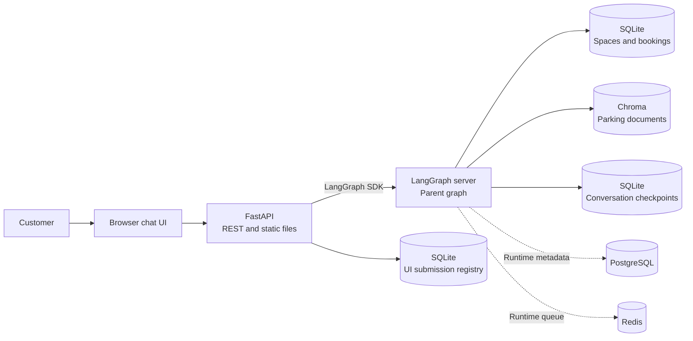
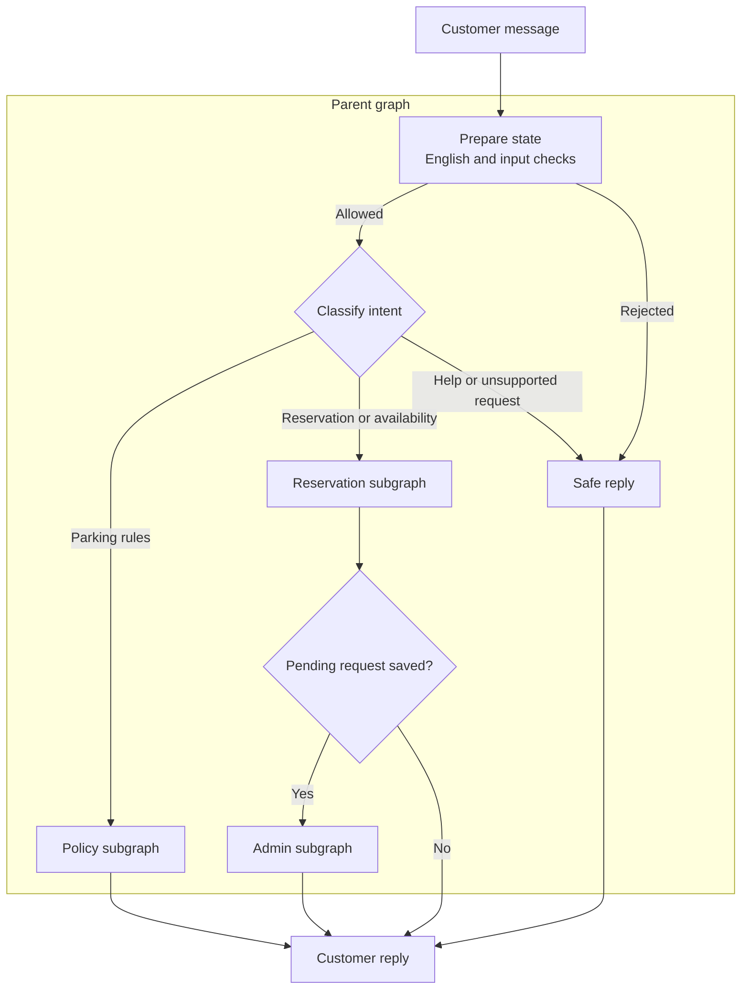

# Parking Reservation Assistant

A local chat application for finding parking, checking prices and rules, and
requesting a reservation. It combines a LangGraph agent, a FastAPI-backed web
UI, a SQLite booking database, and parking documents stored in Chroma.

The assistant supports four fictional locations: **City Centre**, **Riverside**,
**Station**, and **Airport**. Conversations are in English. The supplied parking
fixtures cover **November 2026**.

## What it does

- Finds spaces and prices for a location, date, space type, and visit interval.
- Collects booking details across turns and asks for missing information.
- Converts natural-language dates and times into structured reservation fields.
- Creates a pending hold and automatically reviews it before confirmation.
- Answers parking-policy questions using retrieved documents and citations.
- Keeps customer details out of public availability results and chat responses.

## Architecture



The API serves the UI and forwards chat requests to the graph server. The parent
LangGraph coordinates three **compiled subgraphs**. They share the relevant
state keys; the admin agent is part of the graph and runs automatically.



| Subgraph | Responsibility |
| --- | --- |
| **Policy** | Retrieves relevant Chroma pages using BM25 (0.4) and vector search (0.6), assesses the evidence, and composes a cited answer. If the evidence is insufficient, it may rewrite the question and retrieve once more. |
| **Reservation** | Extracts each supplied field into a structured draft, looks up spaces and prices in SQLite, and uses a tool loop to inspect the draft and ask for missing details. A complete submitted draft becomes a pending hold and a summary. |
| **Admin** | Checks the shared draft and summary against the saved request, makes a structured approve/reject decision, and calls a fixed persistence tool. It returns `admin_result` to the parent for the final reply. |

The parent currently chooses one route per message. A message combining an
availability request with a separate rules question may need a follow-up to
address both parts.

### Reservation flow

1. The customer supplies a location and visit details. Searches are scoped to the
   location and, when provided, the date and space type. Exact start and end times
   are needed to check interval availability.
2. The assistant offers spaces and prices, saves the customer's selection, and
   asks for any missing first name, surname, vehicle plate, or visit times. Dates
   are normalized to the **Europe/Warsaw** time zone.
3. A complete request is written to `booking_requests` as `pending`. The hold
   prevents overlapping requests for the same space and interval.
4. The admin subgraph reviews the saved request. On approval, it rechecks slot
   rules and overlaps and writes a `confirmed` row to `reservations` in the same
   transaction that marks the request `approved`. Rejection marks the request
   `rejected` and creates no confirmed reservation.
5. The parent returns the persisted decision. Conversation checkpoints retain
   the draft and earlier query evidence across turns.

Availability uses reservation intervals, not the fixture's snapshot flag.
Cancellation is not implemented.

## Technology

| Area | Used here |
| --- | --- |
| Agent orchestration | LangChain and LangGraph |
| Chat model | `gpt-6-luna` via `ChatOpenAI` |
| Document retrieval | Chroma, OpenAI embeddings, and BM25/vector search |
| Web application | FastAPI, LangGraph SDK, HTML, CSS, and JavaScript |
| Persistence | SQLite for bookings, checkpoints, and the UI registry; PostgreSQL and Redis for the graph server runtime |
| Deployment | Docker Compose |

## Getting started

### Requirements

- Python 3.12, [uv](https://docs.astral.sh/uv/), and Docker Compose.
- An `OPENAI_API_KEY` for the chat model and query embeddings.
- A `LANGSMITH_API_KEY` with the required Agent Server access, or an applicable
  `LANGGRAPH_CLOUD_LICENSE_KEY`. The graph server needs access to LangSmith
  authentication even if tracing is disabled.
- A root `.env` file containing the credentials. Keep credentials out of Git.

From the repository root:

```powershell
uv sync --dev

# Run only if the booking fixture database is missing.
uv run python ingested_mock_data/seed_database.py

# Build the graph first; the API image uses it as its base.
$env:PYTHONUTF8="1"
uv run langgraph build -t parking-graph:phase01
docker compose --env-file .env -f docker/compose.yaml up -d --build --wait
```

Open **http://127.0.0.1:8080**. The graph server is available locally at port
`8123`, and Chroma at port `8000`. Compose starts the API after the graph passes
its health check.

The application reuses the `parking_documents` Chroma collection. If the
collection has not been ingested, start the Chroma service and follow the
[fixture and ingestion guide](ingested_mock_data/README.md). Ingestion calls the
embedding API; normal startup does not re-embed the PDFs. Restart the graph after
updating the corpus to refresh the cached keyword index.

This is a trusted local demo without customer or administrator login. Published
service ports bind to loopback.

## Storage

| Data | Location |
| --- | --- |
| Spaces, booking requests, and confirmed reservations | `ingested_mock_data/parking_november_2026.sqlite3` |
| Graph conversation checkpoints | `.runtime/graph/checkpoints.sqlite3` |
| UI ownership and submission ledger | `.runtime/application.sqlite3` |
| Graph server scheduling and metadata | Compose PostgreSQL volume |
| Parking document collection | Compose Chroma volume |

The SQLite fixture contains daily space records for November 2026. The booking
migration preserves existing reservation rows while removing the original
November 1-10 date restriction. PostgreSQL, Redis, Chroma, and the application
services are defined in [`docker/compose.yaml`](docker/compose.yaml).

## Project layout

```text
src/parking/
  graph/          Parent graph, subgraphs, state, and tools
  api/            REST endpoints, SDK gateway, and UI request tracking
  web/            Browser chat UI
  bookings.py     SQLite availability and transactional booking writes
  retrieval.py    Chroma and BM25/vector document retrieval
  checkpoint.py   SQLite checkpoint adapter
ingested_mock_data/  Fixture scripts and policy PDFs
docker/             Compose configuration and API Dockerfile
tests/              Unit and integration tests
```

## Tests

Offline tests use temporary storage and mock provider calls. To avoid external
trace uploads during the test run:

```powershell
$env:LANGSMITH_TRACING="false"
$env:LANGCHAIN_TRACING_V2="false"
uv run pytest -q
node --test tests/web/chat.test.mjs
```

The external Chroma and deployed-service tests are opt-in; their prerequisites
are documented in the corresponding files under `tests/integration/`.
